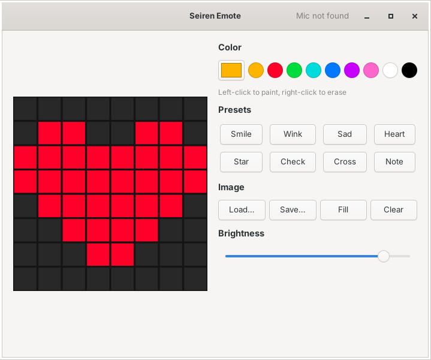

# seiren-emote-linux

Linux support for the **Razer Seiren Emote** microphone's 8×8 LED display. Razer only supports it through Synapse on Windows, and OpenRazer doesn't cover it. This project lets you draw on it, show images and animated GIFs, and have your emote come back automatically when you plug the mic in.



> The microphone audio already works on Linux out of the box. This project only adds control of the LED display.

## Features

- **Desktop app (GTK 4):** paint pixels, pick colors, load PNG/GIF, built-in presets, brightness slider
- **Command line:** `emote preset heart`, `emote image cat.gif --loop`, `emote color ff0000`, `emote off`
- **No sudo:** a udev rule gives your user access
- **Restores on plug-in:** your last image (or animation) is re-applied automatically
- Survives a flaky USB cable: reconnects if the display controller drops off the bus

## Install

```bash
git clone https://github.com/CryMoarz/seiren-emote-linux.git
cd seiren-emote-linux
./install.sh
```

The installer puts everything under `~/.local`, installs missing dependencies with your package manager (apt, dnf or pacman), and adds one udev rule (this asks for sudo). **Unplug and replug the mic once afterwards.**

Dependencies, if you'd rather install them yourself: pyusb, Pillow, PyGObject + GTK 4 (and `python3-gi-cairo` on Debian/Ubuntu).

To remove: `./uninstall.sh`

## Usage

Open **Seiren Emote** from your app menu, or:

```bash
emote gui                     # desktop app
emote preset smile            # smile, wink, sad, heart, star, check, cross, note
emote image heart.png         # any image, scaled to 8x8 (pixel art looks best)
emote image dance.gif --loop  # animated GIF, Ctrl+C to stop
emote color 00ff88            # solid color
emote brightness 120          # 0-255
emote off
emote info                    # firmware / serial / brightness
```

You get the best results by drawing at exactly 8×8 pixels. Larger images are scaled down.

## Troubleshooting

- **"not found"**: check `lsusb | grep 1532:0f1b`. If only `1532:0524` shows up, replug the mic or try another cable/port.
- **"Permission denied" / "No permission"**: the udev rule isn't active yet. Replug the mic. If it persists, make sure you're in the `plugdev` group (`groups`; add with `sudo usermod -aG plugdev $USER`, then log out and back in).
- **Display flickers off / random disconnects**: usually the USB cable. The tool reconnects automatically, but a bad cable will make it happen often.
- **Animations are slow**: each frame takes 5 USB packets, so expect roughly 4–5 fps max.

## Tested on

| Distro | Mic firmware | Status |
|---|---|---|
| Ubuntu 24.04 | 1.0 | ✅ images, presets |

Got it working on something else? Please open an issue or PR to add a row.

## How it works

The Emote is two USB devices in one: the audio interface (`1532:0524`) and a separate LED controller (`1532:0F1B`). The controller speaks Razer's standard 90-byte feature-report protocol, so this project talks to it over libusb control transfers, with no kernel module. Full details are in [PROTOCOL.md](PROTOCOL.md). They should make it straightforward to add support to [OpenRazer](https://openrazer.github.io) one day.

## Contributing

Issues and PRs are welcome, especially:

- saving an image to the mic's onboard memory
- OpenRazer / Polychromatic integration
- testing on other distros and firmware versions

Run the tests (no mic needed): `python3 -m unittest tests/test_device.py`

## Disclaimer

Not affiliated with or endorsed by Razer Inc. "Razer" and "Seiren" are trademarks of Razer Inc. This is an unofficial community tool. Use it at your own risk.

## License

MIT
